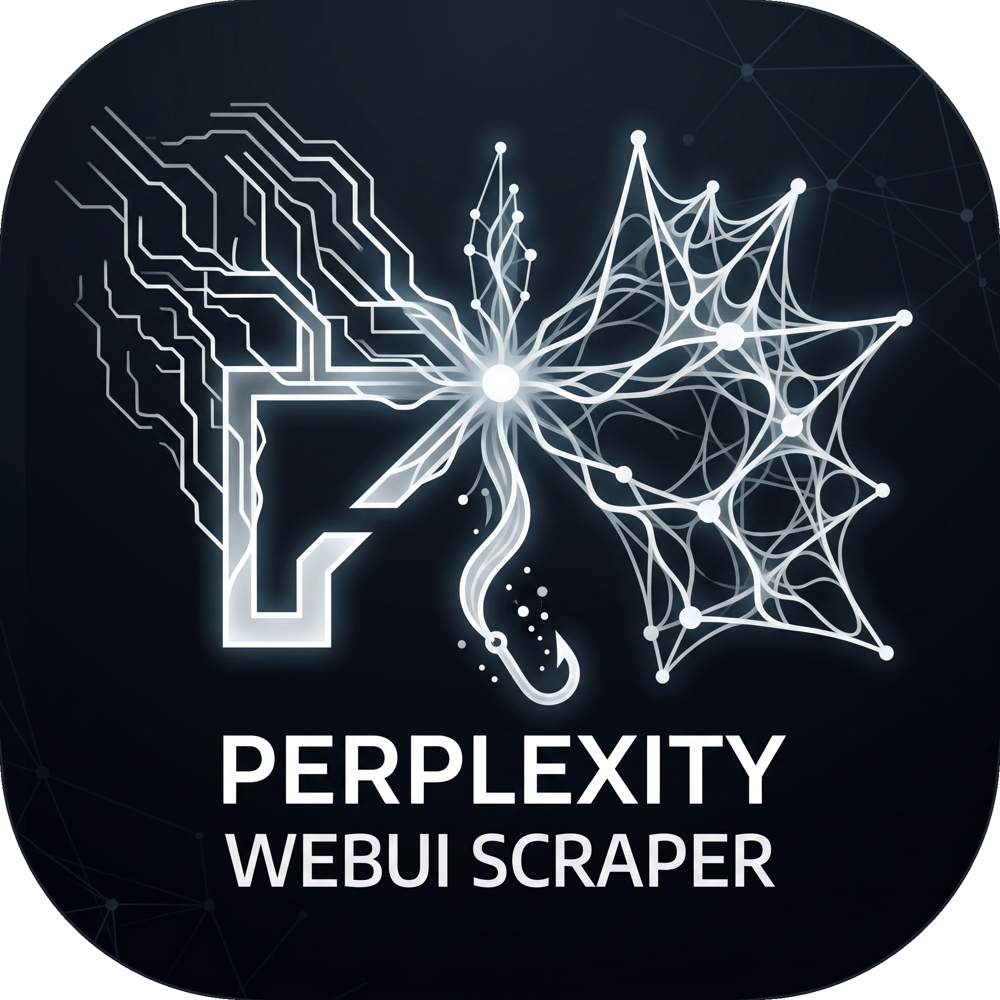

<div align="center">



# Perplexity WebUI Scraper

Unofficial Python client for [Perplexity's](https://www.perplexity.ai) WebUI-backed endpoints. It does not scrape page HTML.

[](https://pypi.org/project/perplexity-webui-scraper)
[](https://pypi.org/project/perplexity-webui-scraper)
[](https://github.com/henrique-coder/perplexity-webui-scraper/blob/prod/LICENSE)

</div>

Documentation: [perplexity-webui-scraper.readthedocs.io](https://perplexity-webui-scraper.readthedocs.io)

## About

This unofficial client uses undocumented Perplexity WebUI endpoints for conversations, file uploads, and streaming; it does not scrape page HTML. The `token` command emits a compact `wsk_` session credential after email login. The library also accepts the raw `__Secure-pplx.session.<UUIDv4>=<JWE>` cookie pair. The compact representation is reversible obfuscation, not encryption or authenticated integrity; treat it as a password.

A Perplexity account and its account-scoped session credential are required. Provide either the raw UUID cookie pair or a compact `wsk_` token. Free accounts support text prompts; paid tiers are required for Pro/Max models and file uploads.

Python `>=3.11, <3.16` is supported. `.python-version` and API/MCP containers use Python 3.15; CI quality, documentation, and package-build jobs use Python 3.14. The test matrix covers every supported minor version across Linux, macOS, and Windows.

## Community

- [Contributing guide](https://github.com/henrique-coder/perplexity-webui-scraper/blob/prod/CONTRIBUTING.md)
- [Security policy](https://github.com/henrique-coder/perplexity-webui-scraper/blob/prod/SECURITY.md)
- [Support guide](https://github.com/henrique-coder/perplexity-webui-scraper/blob/prod/SUPPORT.md)
- [Code of conduct](https://github.com/henrique-coder/perplexity-webui-scraper/blob/prod/CODE_OF_CONDUCT.md)
- [Discussions](https://github.com/henrique-coder/perplexity-webui-scraper/discussions)
- [Sponsor the project](https://github.com/sponsors/henrique-coder)

## Installation

The package is published to PyPI. API and MCP container images are published to GHCR. GitHub Releases include the wheel and source distribution; the project does not publish standalone executables.

### Core library

Install the core Python library without optional features.

```bash
uv add perplexity-webui-scraper
```

### CLI and server extras

Install only the features you need. Use the `token`, `api`, and `mcp` extras individually or together.

```bash
# Install from PyPI
uv add 'perplexity-webui-scraper[token]'  # Email token generator
uv add 'perplexity-webui-scraper[api]'  # REST API server
uv add 'perplexity-webui-scraper[mcp]'  # MCP server
uv add 'perplexity-webui-scraper[all]'  # All optional features
```

## Quick Start

### 1. Get your session token

The base install does not include token-generation dependencies. Install the `token` extra first:

```bash
uv add 'perplexity-webui-scraper[token]'
uv run perplexity-webui-scraper token --email user@example.com
```

The token command accepts an optional `--email` argument and prompts when omitted. It retrieves the UUID-suffixed session cookie and prints a compact `wsk_` credential. Email verification accepts exactly six ASCII digits or an HTTPS Perplexity email callback link for the requested account. Malformed inputs are rejected locally; invalid codes prompt again without resending the email or discarding the current session. Treat the resulting credential as a password.

To convert an existing raw cookie or validate an existing compact credential without network access, run:

```bash
uv run perplexity-webui-scraper token convert
```

Use `token deconvert` to restore a compact `wsk_` token to its raw session-cookie pair. The CLI masks pasted input and never accepts credentials as positional arguments. Conversion does not encrypt the cookie or improve its security.

### 2. Basic usage

```python
from perplexity_webui_scraper import Perplexity

client = Perplexity(session_token="__Secure-pplx.session.<account UUID>=YOUR_VALUE")
conversation = client.create_conversation()

print(client.get_account_profile().account_tier)

conversation.ask("What is quantum computing?")
print(conversation.answer)

# Follow-ups preserve context automatically
conversation.ask("Explain it simpler")
print(conversation.answer)
```

Before each prompt, the library checks `/api/auth/session` and raises `ModelAccessError` if an `available` model requires a higher tier than the authenticated account. When the session payload does not expose enough subscription data, it falls back to `/rest/user/settings`. Models use one of three statuses: `available` (confirmed working normally), `unknown` (not yet verified, including custom identifiers), or `unavailable` (confirmed not working). `is_official` separately records whether a model is listed in Perplexity's official WebUI. `last_tested_at` records the last test in ISO 8601 UTC and is `null` for untested models. Any non-available status requires `allow_risky_model=True`; after acknowledgement, the backend makes the final entitlement decision. Free accounts can use text prompts, but file attachments raise `FileAccessError`.

`perplexity/best` adapts to the account tier: free accounts use Perplexity's internal `turbo` preference, while Pro/Max accounts use `pplx_pro_upgraded`; both use `copilot` mode.

### 3. Streaming

```python
printed = ""
for response in conversation.ask("Explain AI", stream=True):
    current = response.answer or "".join(response.chunks)
    if current.startswith(printed):
        delta = current[len(printed) :]
        print(delta, end="", flush=True)
        printed = current
    elif current:
        printed = current
        print(f"\r{printed}", end="", flush=True)
```

### 4. Choose a model

```python
from perplexity_webui_scraper import ConversationConfig

conversation = client.create_conversation(ConversationConfig(model="perplexity/best"))
conversation.ask("Solve this step by step: ...")
print(conversation.answer)
```

### 5. List registered models

```python
from perplexity_webui_scraper import MODELS

for model in MODELS.list_all():
    print(f"{model.id:40} {model.name}")
```

## CLI commands

Use `-h` or `--help` with the root command or any subcommand. The token command accepts `-e` or `--email`.

| Command                                           | Extra   | Description                                                                     |
| ------------------------------------------------- | ------- | ------------------------------------------------------------------------------- |
| `perplexity-webui-scraper token -e/--email EMAIL` | `token` | Authenticate and print a compact `wsk_` account session credential              |
| `perplexity-webui-scraper token convert`          | `token` | Convert a raw cookie or validate a compact credential offline with masked input |
| `perplexity-webui-scraper token deconvert`        | `token` | Restore a compact `wsk_` credential to its raw session-cookie pair              |
| `perplexity-webui-scraper api`                    | `api`   | Start the OpenAI-compatible REST API server                                     |
| `perplexity-webui-scraper mcp`                    | `mcp`   | Start the MCP server                                                            |

## API

### Chat Completions API

`POST /v1/chat/completions` is the only text-generation endpoint. It is a read-only question-answering mirror of Perplexity's WebUI and automatically prepends a master system instruction rejecting autonomous agent loops and tool execution. It supports streaming, validated base64 image Data URLs, and account-scoped thread continuation with `perplexity.thread_uuid`. Responses contain final assistant text. `GET /v1/models` lists registered model identifiers. The API does not expose hidden chain-of-thought, execute client tools, or fetch remote image URLs.

```bash
# Start with clients supplying the Perplexity account session-cookie pair per request
perplexity-webui-scraper api

# Optional server-default account session-cookie pair, protected by a separate gateway key
PERPLEXITY_SESSION_TOKEN="__Secure-pplx.session.<account UUID>=YOUR_VALUE" PERPLEXITY_API_KEY="$GATEWAY_KEY" perplexity-webui-scraper api

# Custom host and port
perplexity-webui-scraper api --host 0.0.0.0 --port 8080

# Development mode with auto-reload
perplexity-webui-scraper api --reload
```

### Container deployment with Podman

```bash
# Pull the published multi-arch API image
podman pull ghcr.io/henrique-coder/perplexity-webui-scraper:latest

# Run the server (exposing port 8000)
podman run --rm -p 8000:8000 ghcr.io/henrique-coder/perplexity-webui-scraper:latest
```

Optional MCP image for containerized stdio setups:

```bash
# Pull the published multi-arch MCP image
podman pull ghcr.io/henrique-coder/perplexity-webui-scraper:mcp

# Run MCP server (requires token)
podman run --rm -e PERPLEXITY_SESSION_TOKEN=your_token ghcr.io/henrique-coder/perplexity-webui-scraper:mcp
```

For local development, you can still build the provided container files:

```bash
# API image: installs the `api` extra, exposes port 8000, and starts the REST server.
podman build -t perplexity-api -f Containerfile .
podman run --rm -it -p 8000:8000 perplexity-api

# MCP image: installs the `mcp` extra and starts the stdio MCP server. It does not expose an HTTP port.
podman build -t perplexity-mcp -f Containerfile.mcp .
podman run --rm -it -e PERPLEXITY_SESSION_TOKEN=your_token perplexity-mcp
```

### CLI options

| Option            | Short | Default     | Description                                                            |
| ----------------- | ----- | ----------- | ---------------------------------------------------------------------- |
| `--host`          | `-H`  | `127.0.0.1` | Bind address                                                           |
| `--port`          | `-p`  | `8000`      | Port to listen on                                                      |
| `--reload`        |       | `False`     | Enable auto-reload (development only)                                  |
| `--log-level`     |       | `info`      | Uvicorn log level                                                      |
| `--session-token` |       | unset       | Optional server-default Perplexity token (`PERPLEXITY_SESSION_TOKEN`)  |
| `--api-key`       |       | unset       | Gateway key required when a server token is set (`PERPLEXITY_API_KEY`) |

### Authentication

Without a server-default credential, send either the raw `__Secure-pplx.session.<UUIDv4>=<JWE>` pair or compact `wsk_` token in `Authorization: Bearer`. When `PERPLEXITY_SESSION_TOKEN` is configured on the server, requests may omit `Authorization` but must include the separate gateway key in `X-API-Key`. A caller credential can override the server default after gateway authentication.

```bash
# curl
export PERPLEXITY_SESSION_TOKEN='YOUR_TOKEN'
curl http://localhost:8000/v1/chat/completions \
  -H "Authorization: Bearer $PERPLEXITY_SESSION_TOKEN" \
  -H 'Content-Type: application/json' \
  -d '{"model": "perplexity/best", "messages": [{"role": "user", "content": "Hello!"}]}'

# Streaming
curl -N http://localhost:8000/v1/chat/completions \
  -H "Authorization: Bearer $PERPLEXITY_SESSION_TOKEN" \
  -H 'Content-Type: application/json' \
  -d '{"model": "perplexity/best", "messages": [{"role": "user", "content": "Hello!"}], "stream": true}'
```

```python
from openai import OpenAI

client = OpenAI(
    base_url="http://localhost:8000/v1",
    api_key="__Secure-pplx.session.<account UUID>=YOUR_VALUE",
)

response = client.chat.completions.create(
    model="perplexity/best",
    messages=[{"role": "user", "content": "Hello!"}],
)
print(response.choices[0].message.content)
```

Chat Completions request with server-configured upstream credentials:

```bash
curl http://localhost:8000/v1/chat/completions \
  -H 'X-API-Key: YOUR_GATEWAY_KEY' \
  -H 'Content-Type: application/json' \
  -d '{"model":"perplexity/best","messages":[{"role":"user","content":"Hello!"}]}'
```

### API endpoints

| Method | Path                   | Description                                        |
| ------ | ---------------------- | -------------------------------------------------- |
| `GET`  | `/v1/models`           | List registered models                             |
| `POST` | `/v1/chat/completions` | Chat Completions API (streaming and non-streaming) |
| `GET`  | `/docs`                | Interactive Swagger UI                             |
| `GET`  | `/redoc`               | ReDoc API documentation                            |

> Chat Completions implements a documented subset of the OpenAI contract. Unsupported fields may be ignored. The API returns final text, not hidden reasoning or client-executable tools.

## MCP server

Expose every Perplexity model as a separate tool for AI agents (Claude Desktop, Antigravity, etc.):

```json
{
  "mcpServers": {
    "perplexity-webui-scraper": {
      "command": "uvx",
      "args": [
        "--from",
        "perplexity-webui-scraper[mcp]",
        "perplexity-webui-scraper",
        "mcp"
      ],
      "env": { "PERPLEXITY_SESSION_TOKEN": "your_token_here" }
    }
  }
}
```

See the [MCP documentation](https://perplexity-webui-scraper.readthedocs.io/page/mcp-server/) for tools and configuration.

## Disclaimer

This is an **unofficial** library. It uses internal APIs that may change without notice. Use at your own risk. By using this library, you agree to Perplexity AI's [Terms of Service](https://www.perplexity.ai/hub/legal/terms-of-service).
